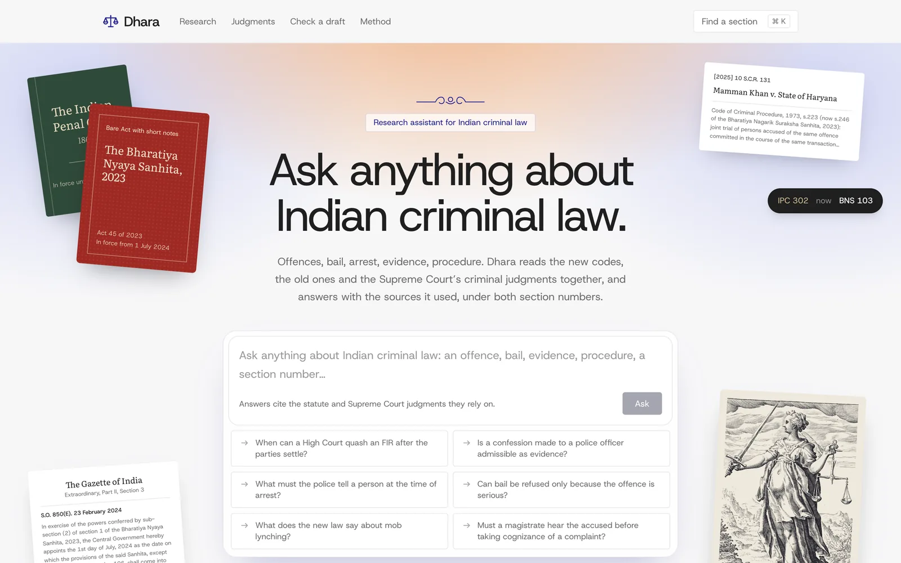
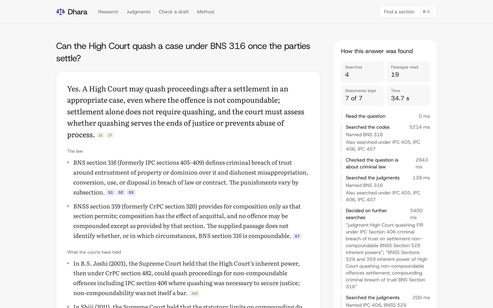
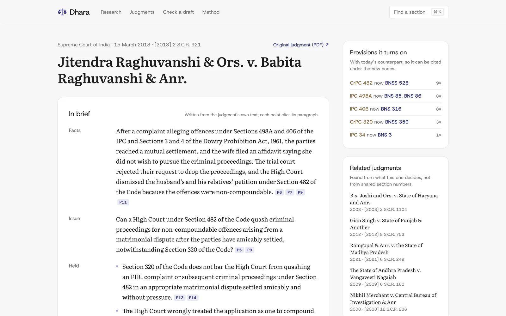
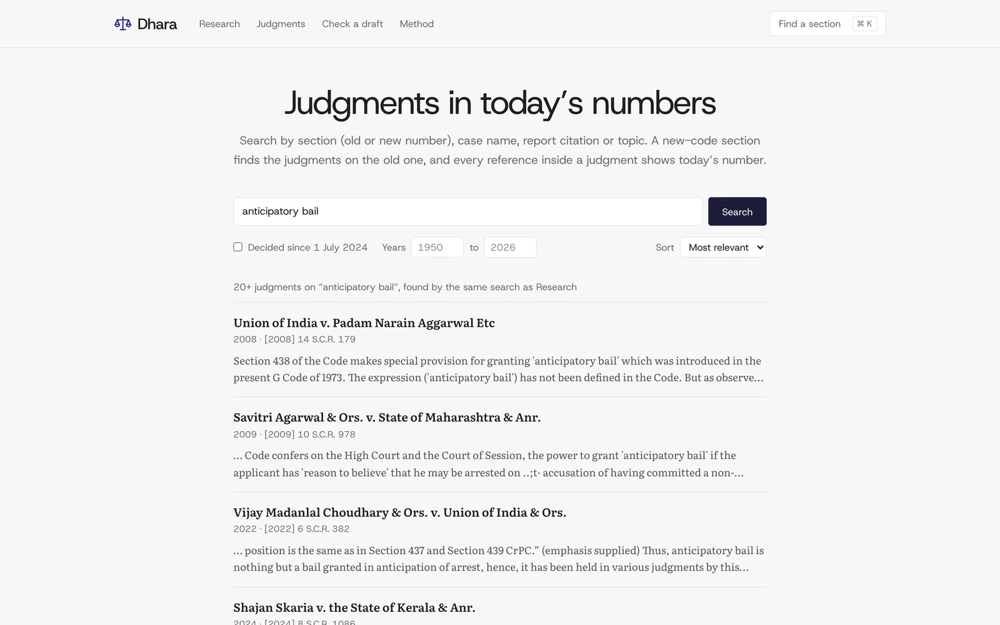
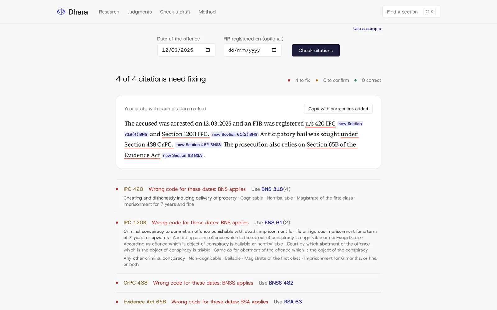
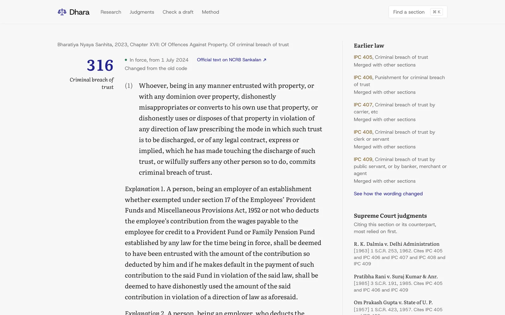
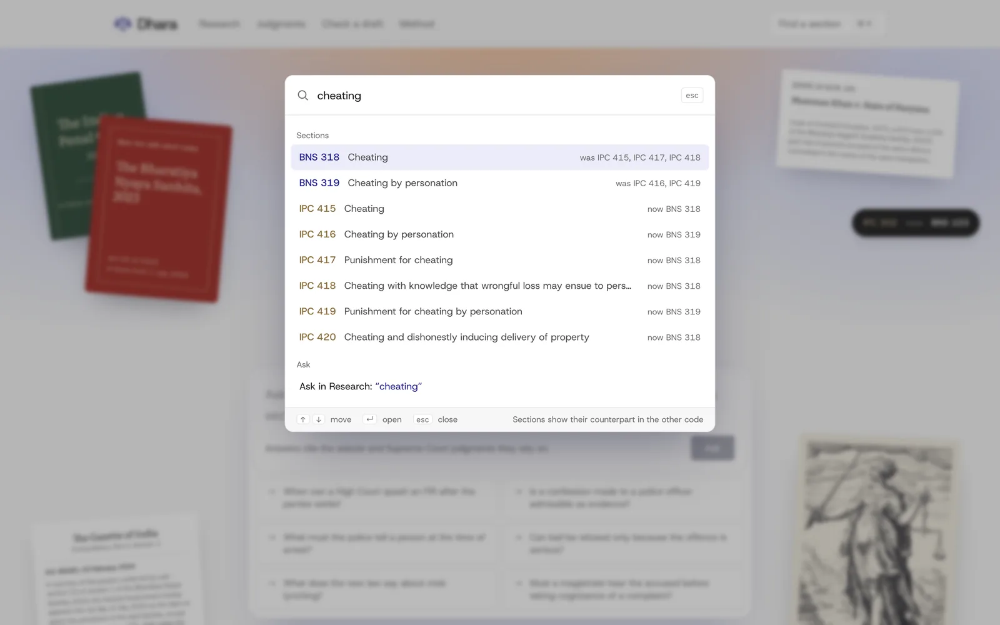
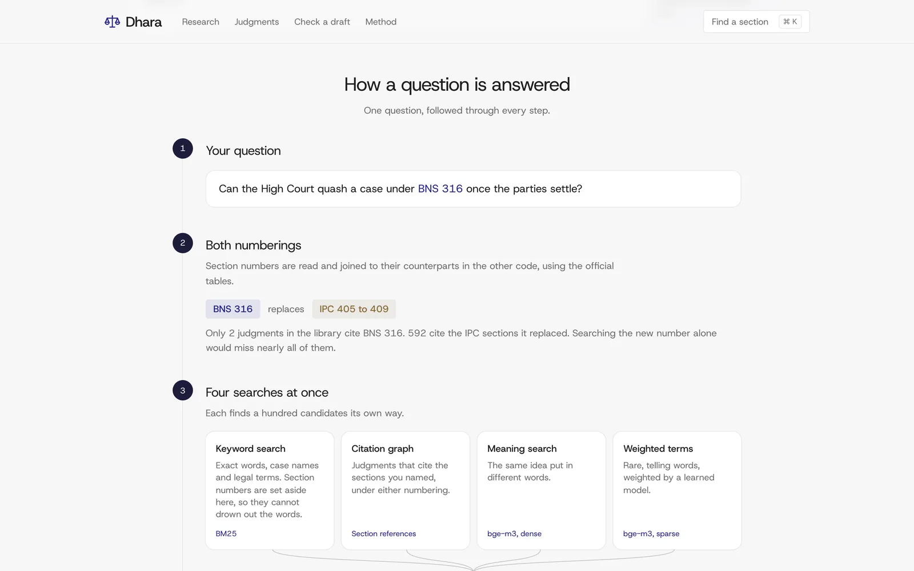
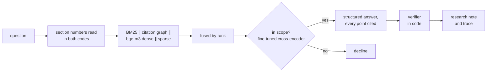

<div align="center">
  
# Dhara

**Research Indian criminal law across the 2024 change of codes.**

Statutes and 9,686 Supreme Court judgments, searched under the old and new section numbers at once, with every citation checked in code before it is shown.
</div>

## About

On 1 July 2024 the Bharatiya Nyaya Sanhita, Nagarik Suraksha Sanhita and Sakshya Adhiniyam replaced the IPC, CrPC and Evidence Act, and every section got a new number. The judgments a lawyer relies on still cite the old ones: in Supreme Court criminal judgments decided after July 2024, old-code citations outnumber new ones about 19 to 1. A search for "BNS 103" misses the 3,455 judgments on IPC 302. Dhara is built around that gap.

- **Research.** Ask in your own words or by section. The answer reads like a research note: the law, what the courts have held, what follows in practice, and the cases to cite with the proposition each supports, its year, report citation and bench. Every statement cites a passage, follow-up questions keep the context, and a trace shows every search that was run.
- **Judgments.** Search the library by section (old or new number), case name, report citation or topic. Each judgment opens with a brief in which every point cites its paragraph, answers questions from its own text, lists related judgments, and marks each old section in the text with today's number.
- **Check a draft.** Paste an FIR, chargesheet or draft. Each citation is checked against the code in force on the offence date (and the FIR date for procedure) and corrected down to the subsection where the official tables allow, with the First Schedule classification of the offence.
- **Section pages.** Any section, old or new, through ⌘K: full text, its counterpart, the changed words marked, the First Schedule row and the judgments on it, with a link to the official text.
- **Hybrid retrieval with a citation graph.** BM25, a retriever over the passages that cite the named sections (or their counterparts), and bge-m3 dense and sparse search, fused by rank. A cross-encoder fine-tuned on pairs mined from the corpus decides whether a question is in scope.
- **A verifier, not a promise.** Code, not a model, drops any statement that cites a passage it wasn't given, names a section that doesn't exist, or presents a repealed section as current law.
- **Its own benchmark.** DharaBench measures every retrieval stage on questions whose answers are known, including new-code questions answered by judgments that cite only the old code.

> [!NOTE]
> Dhara is a research aid, not legal advice. It covers the six criminal codes and the Supreme Court's criminal judgments, May 1950 to 7 September 2026.

## Screenshots

<table>
  <tr>
    <td width="50%"><br>Home: ask a question or open a tool</td>
    <td width="50%"><br>Research: a cited research note, the cases to cite and the trace of every search</td>
  </tr>
  <tr>
    <td width="50%"><br>A judgment: cited brief, the provisions it turns on in today's numbers, related judgments</td>
    <td width="50%"><br>Judgments: search by section, name, citation or topic, with filters</td>
  </tr>
  <tr>
    <td width="50%"><br>Check a draft: outdated citations marked, corrected and classified</td>
    <td width="50%"><br>Section page: the new text against the old, with the changes marked</td>
  </tr>
  <tr>
    <td width="50%"><br>⌘K: sections in either numbering, judgments by name, or ask</td>
    <td width="50%"><br>Method: how a question is answered, step by step, with the measured results</td>
  </tr>
</table>

## How it works



A question about BNS 103 is mapped to IPC 302 through NCRB's official tables, and one retriever searches only the judgment passages that cite either. That citation graph is fused with keyword and bge-m3 search. Before any statement reaches the page, code checks that every citation points to a passage that was retrieved and to a section that exists and was in force.

**More:** [architecture and design choices](docs/architecture.md)

## Results

On the held-out test split (150 new-code questions whose answer is a judgment that cites only the old code):

| Setup | Right judgment in top 10 |
|---|---|
| Keyword search, question as typed | 0.27 |
| Plain RAG (dense search only) | 0.31 |
| + section numbers read through the citation graph | 0.37 |
| **Live pipeline: four retrievers, citation graph weighted ×2** | **0.38** |

Three rerankers were measured on top, including one fine-tuned on pairs mined from the corpus and an LLM reranker. None beat the live fusion at finding old-code precedent on both splits, and each added 6 to 12 seconds per search, so the fine-tuned model is used only to decide whether a question is in scope (balanced accuracy 0.88).

**More:** [benchmark, full ablation and component checks](docs/evaluation.md)

## Tech stack

Python 3.12 · FastAPI · SQLite · bm25s · BAAI/bge-m3 · sentence-transformers · PyTorch · OpenAI API · Next.js 16 · React 19 · TypeScript · Tailwind CSS 4 · Docker · GitHub Actions

## Getting started

```bash
git clone https://github.com/Arav-Arun/Dhara.git && cd Dhara
make setup && npm --prefix web install && cp .env.example .env
make statutes mapping judgments index    # build the data (~4.4 GB download, resumable)
make api                                 # http://localhost:8787
make web                                 # http://localhost:3000
```

**More:** [setup, scripts and settings](docs/setup.md) · [deployment](docs/deploy.md)

## Project structure

```
dhara/     Python package: ingestion, retrieval, generation, verification, evaluation, API
web/       Next.js site
eval/      DharaBench questions and results
tests/     pytest suite
docs/      architecture, evaluation, setup, deployment
```

## Limits

- **Supreme Court judgments only,** by design, and a snapshot to 7 September 2026.
- **Citations are checked, meaning is not.** Whether a sentence says what its passage says still needs a reader.

## Data and licence

**Dataset:** the statutes, the official mapping, the citation graph and DharaBench are published on [Hugging Face](https://huggingface.co/datasets/AravArun/dhara-indian-criminal-law) and [Kaggle](https://www.kaggle.com/datasets/aravarun/dhara-indian-criminal-law).

Statutes and the NCRB tables are not protected by copyright in India. Judgments come from the Indian Supreme Court Judgments dataset (Dattam Labs, AWS Open Data, CC-BY-4.0). The site's engravings are public-domain prints from the Rijksmuseum. Code: MIT © Arav Arun.
