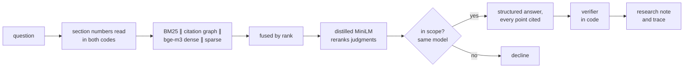
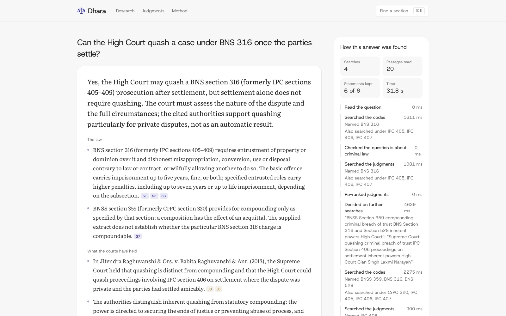
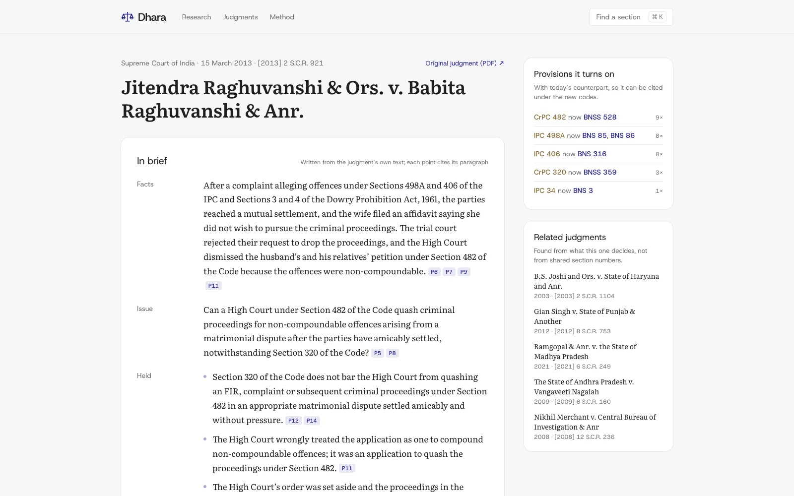
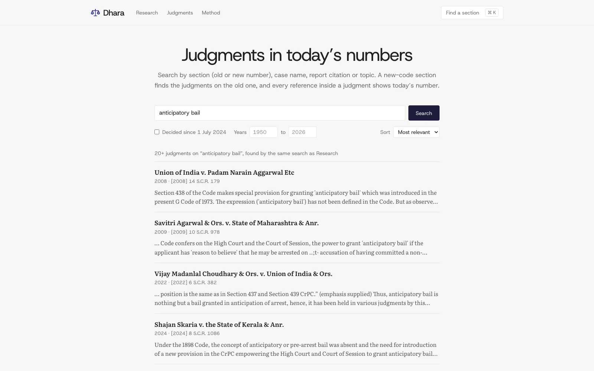
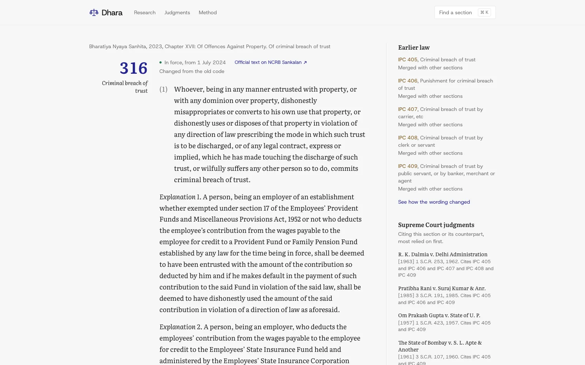
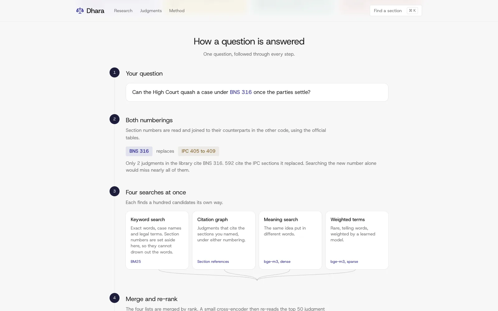

<div align="center">
  
# Dhara

**A retrieval-augmented research system for Indian criminal law, built for the 2024 change of codes.**

It finds Supreme Court precedent under the old and the new section numbers at once, answers from it, and checks every citation in code before it is shown.

**[Try it live at dhara.aravarun.in](https://dhara.aravarun.in)**

[](LICENSE)
[](https://huggingface.co/AravArun/dhara-reranker)
[](https://huggingface.co/datasets/AravArun/dhara-indian-criminal-law)
</div>

## The problem

On 1 July 2024 the Bharatiya Nyaya Sanhita, Nagarik Suraksha Sanhita and Sakshya Adhiniyam replaced the IPC, CrPC and Evidence Act, and every section got a new number. The judgments a lawyer relies on still cite the old ones: in Supreme Court criminal judgments decided after July 2024, old-code citations outnumber new ones about 19 to 1. A search for "BNS 103" misses the 3,455 judgments on IPC 302, and plain dense RAG finds the right judgment for only 31% of such questions.

## How it works



1. **A citation graph across both numberings.** Section numbers in a question are mapped to their counterparts through NCRB's official correspondence tables, and one retriever searches only the judgment passages that cite either. A question about BNS 103 reaches the judgments on IPC 302.
2. **Hybrid retrieval, fused by rank.** That retriever runs alongside BM25 (with section numbers set aside, since judgments mostly use the old ones) and bge-m3 dense and sparse search, merged by reciprocal rank fusion.
3. **A small distilled reranker that also gates scope.** A MiniLM cross-encoder (22.7M parameters), distilled from a bge-reranker-v2-m3 fine-tuned on the corpus, reorders the top 50 judgment passages on a CPU-only server. Its score over the retrieved statutes decides whether a question is about criminal law at all; if not, Dhara declines.
4. **Answers that can't cite what they weren't given.** The model writes a structured answer from the retrieved passages only, and may run at most two more searches, each shown in the trace. Code, not a model, then drops any statement that cites a passage it wasn't given, names a section that doesn't exist, or presents a repealed section as current law. Checked parts stream to the page as they are written.

**More:** [architecture and design choices](docs/architecture.md)

## Results

DharaBench, built from the corpus, has 1,148 questions with known answers in held-out dev and test splits. On the 450 test questions whose answer is a Supreme Court judgment, many of them asked with new-code numbers about a judgment that cites only the old code:

| Setup | Right judgment in top 10 |
|---|---|
| Keyword search, question as typed | 0.28 |
| Plain RAG (dense search only) | 0.31 |
| Keyword search + citation graph | 0.40 |
| LLM reranker over the four retrievers | 0.40 |
| Fine-tuned bge-reranker-base over the four retrievers | 0.42 |
| **Live: four retrievers + distilled MiniLM reranker** | **0.45** |

- **The citation graph is the main gain:** 0.28 to 0.40 before any model reranks.
- **A larger benchmark overturned an earlier result.** On 150 questions per split, fine-tuning the reranker looked like a clear win. Tripled to 450, fine-tuned rerankers no longer beat off-the-shelf ones, and the earlier gain turned out to be within the noise of the smaller set.
- **Distillation kept the accuracy at a fraction of the cost.** The MiniLM ties the base-sized rerankers on dev and does best on test, at a fifth of their compute and a twenty-fifth the size of the model it learned from. Full research answers take about 20 to 30 seconds on the live site, down from about 55.
- **Two ideas were measured and dropped:** rewriting plain questions into legal terms before search, and a cheaper scope check over 5 statutes instead of 20. Both made results worse.

**More:** [benchmark, full ablation and component checks](docs/evaluation.md)

## What it does

- **Research.** Ask in your own words or by section. The answer reads like a research note: the law, what the courts have held, and the cases to cite, each with the proposition it supports, its year and report citation. Follow-up questions keep the context.
- **Judgments.** Search by section (old or new number), case name, citation or topic. Each judgment opens with a cited brief, answers questions from its own text, and marks every old section in it with today's number.
- **Section pages.** Any section, old or new, through ⌘K: its text, its counterpart in the other code with the changed words marked, and the judgments on it.

> [!NOTE]
> Dhara is a research aid, not legal advice. It covers the six criminal codes and the Supreme Court's criminal judgments, May 1950 to 7 September 2026.

## Screenshots

<table>
  <tr>
    <td width="50%"><br>Home: ask a question or open a tool</td>
    <td width="50%"><br>Research: a cited research note, the cases to cite and the trace of every search</td>
  </tr>
  <tr>
    <td width="50%"><br>A judgment: cited brief, the provisions it turns on in today's numbers, related judgments</td>
    <td width="50%"><br>Judgments: search by section, name, citation or topic, with filters</td>
  </tr>
  <tr>
    <td width="50%"><br>Section page: the new text against the old, with the changes marked</td>
    <td width="50%"><br>Method: how a question is answered, step by step, with the measured results</td>
  </tr>
</table>

## Tech stack

Python 3.12 · FastAPI · SQLite · bm25s · BAAI/bge-m3 · sentence-transformers · PyTorch · OpenAI API · Next.js 16 · React 19 · TypeScript · Tailwind CSS 4

The API runs on Google Cloud Run and the site on Vercel.

## Getting started

```bash
git clone https://github.com/Arav-Arun/Dhara.git && cd Dhara
make setup && npm --prefix web install && cp .env.example .env
make statutes mapping judgments index    # build the data (~4.4 GB download, resumable)
make api                                 # http://localhost:8787
make web                                 # http://localhost:3000
```

**More:** [setup, scripts and settings](docs/setup.md)

## Project structure

```
dhara/     Python package: ingestion, retrieval, reranking, generation, verification, evaluation, API
web/       Next.js site
eval/      DharaBench questions and results
tests/     pytest suite
docs/      architecture, evaluation, setup
```

## Limits

- **Supreme Court judgments only,** by design, and a snapshot to 7 September 2026.
- **Citations are checked, meaning is not.** Whether a sentence says what its passage says still needs a reader.
- **The benchmark counts one right judgment per question,** the one the question was written from, so recall understates how often a useful judgment is found.

## Data and licence

**Dataset:** the statutes, the official mapping, the citation graph and DharaBench are published on [Hugging Face](https://huggingface.co/datasets/AravArun/dhara-indian-criminal-law) and [Kaggle](https://www.kaggle.com/datasets/aravarun/dhara-indian-criminal-law).

Statutes and the NCRB tables are not protected by copyright in India. Judgments come from the Indian Supreme Court Judgments dataset (Dattam Labs, AWS Open Data, CC-BY-4.0). The site's engravings are public-domain prints from the Rijksmuseum. Code: MIT © Arav Arun.
