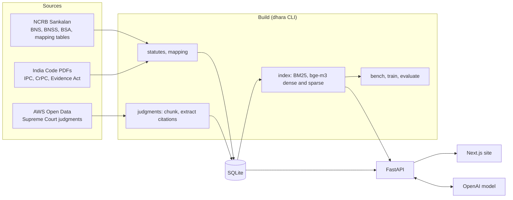
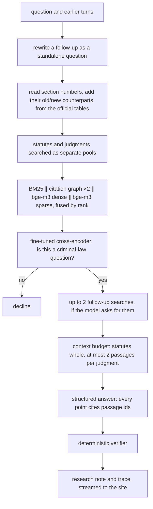
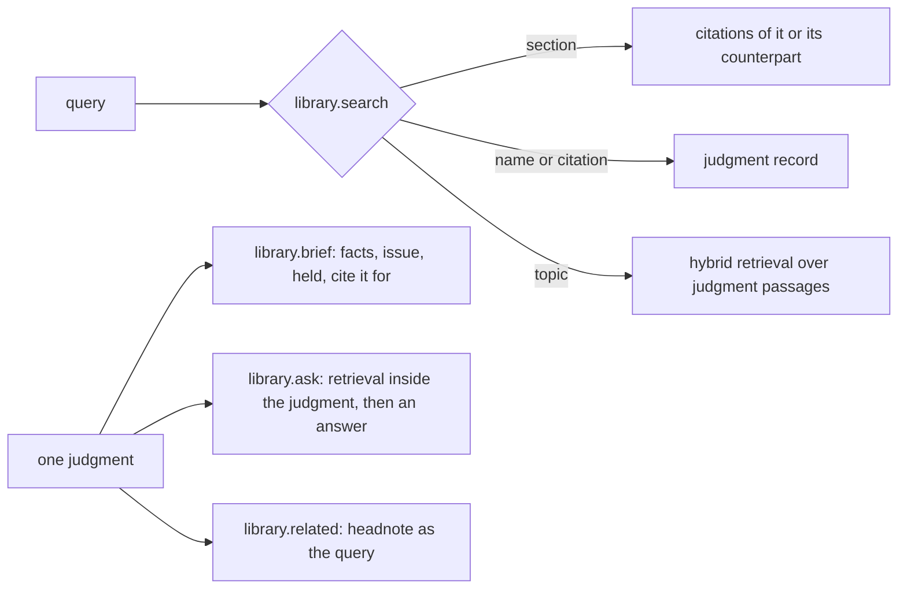
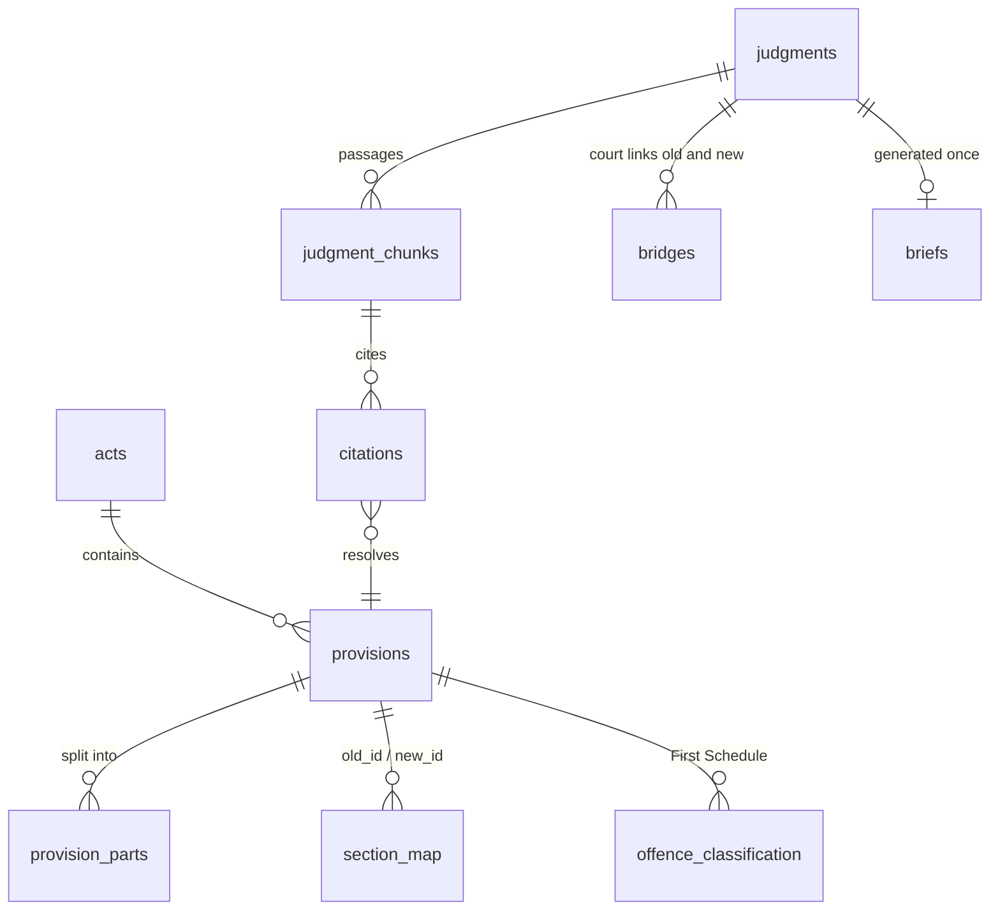

# Architecture

[← Back to the README](../README.md)

## The system

Everything structured (statutes, the mapping, judgments, citations) lives in one SQLite file. The vectors are a NumPy matrix and a SciPy sparse matrix, and BM25 is a `bm25s` index. At about 215k retrieval units they all fit in memory, so search is exact and no vector database or ANN index is needed. The same files run on a laptop and in production.

## Answering a question

| Stage | Code |
|---|---|
| Rewrite, follow-up searches, trace | `dhara/agent.py` |
| Counterparts, retrievers, rank fusion | `dhara/retrieve.py` |
| Scope check and the baseline rerankers | `dhara/rerank.py`, `dhara/train_reranker.py` |
| Context budget and structured answer | `dhara/generate.py` |
| Verifier | `dhara/verify.py` |
| Judgment search, briefs, questions about a judgment | `dhara/library.py` |
| Draft checking and date rules | `dhara/checker.py`, `dhara/rules.py` |

## Design choices

- **Section numbers go to the citation graph, not to keyword search.** A question about BNS 103 is mapped to IPC 302, and one retriever searches only the judgment passages that cite either. In keyword search the same numbers hurt, because judgments mostly use the old ones: "103" matches the wrong documents.
- **The citation graph counts twice in the fusion.** With four retrievers weighted equally, dense and sparse search dilute it. The weight was fixed before measuring and helps on both evaluation splits.
- **The mapping is data, not a model's guess.** Old-to-new links come from NCRB's official tables, with their relation type (renumbered, merged, split, partly moved, new, dropped). Courts' own "corresponding to" phrases are an independent check (94% agreement).
- **One section, one chunk.** Statutes are retrieved whole, split only at subsection boundaries, so a proviso never loses the clause it qualifies. Judgments are chunked by numbered paragraph, so an answer can point at "paras 12–14".
- **The verifier is code.** It drops any statement that cites a passage it wasn't given, names a section that doesn't exist, or presents a repealed section as current law. If more than half the statements fail, Dhara declines to answer.
- **A bounded agent.** After the first search the model may ask for at most two more, through the same retriever, and every call is in the trace. There is no framework and no open-ended loop, so cost and latency stay predictable.
- **Rerankers are measured, not assumed.** Three were tried; none beat the weighted fusion at finding old-code precedent on both splits (see [evaluation](evaluation.md)). The fine-tuned one decides whether a question is in scope instead.
- **Which code applies is a rule.** The offence date decides substantive law; the date proceedings began decides procedure and evidence (BNSS s.531, BSA s.170).
- **Sexual-offence judgments are included.** The official reports anonymise victims, and leaving out 780 judgments left a gap in an area lawyers search often. They carry a `sensitive` flag, so a deployment can filter them.

## Reading a judgment

Briefs and answers about a judgment cite its paragraphs as P1, P2 and so on, and the same rule applies: a point citing a paragraph the model wasn't given is dropped. Each brief is generated once and stored.

## Data model

## Modules

| File | What it does |
|---|---|
| `statutes_ncrb.py`, `statutes_pdf.py`, `statutes.py`, `grammar.py` | the six codes from NCRB HTML and India Code PDFs, split into citable parts and checked against the PDFs |
| `mapping_tables.py`, `mapping.py` | NCRB's correspondence tables, compared with public mapping datasets |
| `judgments.py`, `citations.py` | Supreme Court judgments: select, download, chunk, extract section references |
| `index.py`, `retrieve.py` | retrieval units, BM25 and bge-m3 vectors; four retrievers and rank fusion |
| `rerank.py`, `train_reranker.py` | cross-encoder, multi-vector and LLM rerankers; fine-tuning on mined pairs |
| `generate.py`, `verify.py`, `agent.py` | context budget, structured answers, the verifier, the research pipeline |
| `library.py`, `checker.py`, `rules.py` | judgment search and briefs, draft checking, which code applies |
| `bench.py`, `evaluate.py`, `release.py` | DharaBench, the ablation runner, the dataset export |
| `api.py`, `cli.py`, `config.py`, `db.py`, `llm.py`, `models.py` | the API, the command line, settings, storage, the one place that calls the model |
